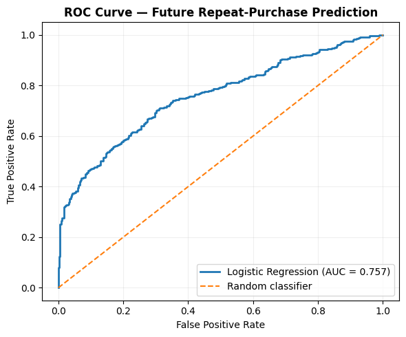

# Predicting Repeat Purchases in Online Retail

An IT3081 Statistical Modelling group project that uses past shopping behaviour to estimate whether an existing customer will buy again within six months. The analysis uses **Online Retail II**, a public dataset with over one million transaction lines from a UK-based retailer.

## Results

| Model | Accuracy | Precision | Recall | F1 | ROC-AUC |
| --- | ---: | ---: | ---: | ---: | ---: |
| Standard logistic regression | 0.6960 | 0.7432 | 0.7177 | 0.7303 | 0.7569 |
| Ridge logistic regression (C = 1) | 0.6948 | 0.7427 | 0.7157 | 0.7290 | 0.7569 |

The majority-class baseline accuracy was **57.34%** on the test set. Ridge regularization produced nearly identical discrimination to the standard model. In the standard model, a one-standard-deviation increase in log-transformed purchase frequency was associated with **2.14× the odds** of a future purchase, holding the other model inputs constant. A one-standard-deviation increase in recency (more days since the last order) was associated with **0.60× the odds**.



The [consultancy presentation](reports/consultancy-presentation.pptx) covers the business recommendations and documents a separate four-model analysis with a different predictor set. Its reported LASSO and elastic-net results are separate from the source notebooks included here.

## Study design

- **Observation window:** 10 June 2010 to 9 June 2011. Constructed customer features from historical merchandise purchases, including frequency, recency, average order value, product diversity, tenure and purchase intervals.
- **Outcome window:** 10 June to 9 December 2011. A positive label means the customer placed at least one merchandise order during this window. Of 4,324 eligible customers, 2,481 purchased again (57.38%).
- **Evaluation:** Split the historical customer cohort into stratified 80% training and 20% test sets, using random seed 42. Fit the scaler on the training customers and evaluated the models on 865 held-out customers.

## Explore the work

| Notebook | What it covers |
| --- | --- |
| [01 · Data profiling](notebooks/01_data_profiling.ipynb) | Missing identifiers, duplicates, cancellations, zero prices and outliers |
| [02 · Cleaning and feature engineering](notebooks/02_data_cleaning_and_feature_engineering.ipynb) | Clean transactions, merchandise lines, orders and customer-level features |
| [03 · Descriptive analysis](notebooks/03_descriptive_analysis.ipynb) | Customer spending, purchase frequency, returns and correlations |
| [04 · Statistical inference](notebooks/04_statistical_inference.ipynb) | Welch's t-test and Welch's ANOVA for differences in log average order value |
| [05 · Repeat-purchase modelling](notebooks/05_repeat_purchase_modelling.ipynb) | Logistic regression, ridge regression, held-out metrics and [odds ratios](reports/figures/repeat-purchase-odds-ratios.png) |
| [07 · Principal component analysis](notebooks/07_principal_component_analysis.ipynb) | Exploratory PCA and [explained variance](reports/figures/pca-explained-variance.png) |
| [08 · Bayesian logistic regression](notebooks/08_bayesian_logistic_regression.ipynb) | PyMC posterior estimates and [95% highest-density intervals](reports/figures/bayesian-coefficient-intervals.png) |

## Run locally

1. Install **Python 3.12**. From the repository root, create a virtual environment:

   ```bash
   python -m venv .venv
   ```

2. Install dependencies and launch JupyterLab using the virtual environment's Python.

   **Windows (PowerShell)**

   ```powershell
   .\.venv\Scripts\python.exe -m pip install -r requirements.txt
   .\.venv\Scripts\python.exe -m jupyterlab
   ```

   **macOS or Linux**

   ```bash
   .venv/bin/python -m pip install -r requirements.txt
   .venv/bin/python -m jupyterlab
   ```

3. Download [Online Retail II from UCI](https://archive.ics.uci.edu/dataset/502/online+retail+ii), extract the archive and place the workbook at `data/raw/online_retail_II.xlsx`.
4. Open the notebooks from `notebooks/` and run them in numeric order. Notebook 02 writes the CSVs to `data/processed/`, and notebooks 03 onward read them. Notebook 01 is exploratory and can be skipped if you only need to regenerate the CSVs. Notebook 08 runs Bayesian sampling and can take several minutes.

Downloaded and generated datasets are kept outside Git. Figures are included so you can review the main outputs without running the notebooks.

## Limitations

The test set estimates performance on held-out customers from the same historical cohort. A later cohort would be needed to test performance over time. The coefficient estimates describe associations in this dataset. The suggested retention interventions and randomized experiments are proposals.

## Data attribution

Chen, D. (2012). *Online Retail II*. UCI Machine Learning Repository. [DOI: 10.24432/C5CG6D](https://doi.org/10.24432/C5CG6D). Dataset licensed under [CC BY 4.0](https://creativecommons.org/licenses/by/4.0/).
